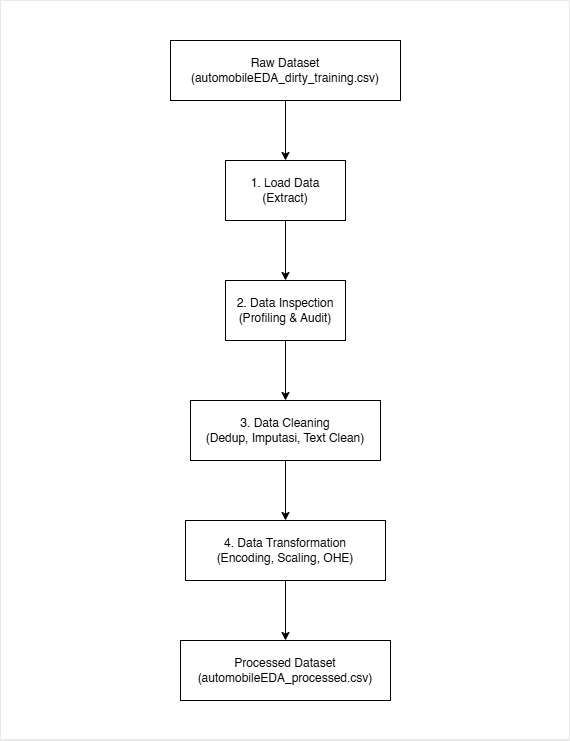

# Automobile Data Engineering Pipeline: ETL & Data Preparation

Proyek ini mengimplementasikan data pipeline lokal berbasis Python dan Pandas untuk membersihkan, menstandarisasi, dan mentransformasi data mentah otomotif (`automobileEDA_dirty_training.csv`) menjadi dataset fitur siap latih untuk model *machine learning* (`automobileEDA_processed.csv`). Seluruh alur kerja mengikuti metodologi ETL (*Extract, Transform, Load*) modular dan tervalidasi secara presisi.

---

## 1. Deskripsi & Sumber Dataset

* **Deskripsi Dataset**: Dataset memuat informasi karakteristik teknis, spesifikasi mesin, dimensi fisik, konsumsi bahan bakar, dan harga dari berbagai model mobil. Data mencakup fitur numerik kontinu (seperti `price`, `horsepower`, `engine-size`), fitur diskrit, serta fitur kategorikal (seperti `make`, `body-style`, `fuel-system`).
* **Sumber Dataset**: Diadaptasi dari repositori publik *Automobile Dataset (UCI Machine Learning Repository)* yang kemudian diinjeksi anomali kotor (*dirty training set*) oleh tim bootcamp untuk simulasi rekayasa data riil.
* **Format File Mentah**: `data/raw/automobileEDA_dirty_training.csv` (CSV dengan pembatas koma).

---

## 2. Struktur Direktori Proyek

```text
data-pipeline-assignment/
├── data/
│   ├── raw/
│   │   └── automobileEDA_dirty_training.csv   # Dataset mentah asli (tidak diubah)
│   └── processed/
│       └── automobileEDA_processed.csv       # Dataset hasil pemrosesan (otomatis)
├── documentation/
│   └── data-flow-diagram.png                 # Diagram alur pipeline ETL
├── src/
│   └── pipeline.py                           # Kode pipeline ETL modular
├── README.md                                 # Dokumentasi komprehensif proyek
└── requirements.txt                          # Dependensi pustaka Python
```

---

## 3. Kondisi Awal Dataset & Temuan Masalah (Data Profiling)

Audit awal terhadap dataset mentah (`automobileEDA_dirty_training.csv`) menghasilkan temuan kualitas data sebagai berikut:

| Aspek Pemeriksaan | Hasil Temuan & Kondisi Awal |
| :--- | :--- |
| **Ukuran Awal Dataset** | 205 baris dan 30 kolom. |
| **Duplikasi Data** | 4 baris duplikat penuh (seluruh nilai atribut identik). |
| **Missing Values (Nilai Kosong)** | Ditemukan total 17 nilai kosong pada 7 kolom:<br>- `stroke`: 4 baris (1.95%)<br>- `horsepower`: 3 baris (1.46%)<br>- `price`: 3 baris (1.46%)<br>- `transaction_date`: 2 baris (0.98%)<br>- `make`: 2 baris (0.98%)<br>- `num-of-doors`: 2 baris (0.98%)<br>- `horsepower-binned`: 1 baris (0.49%) |
| **Tipe Data Belum Sesuai** | - `num-of-doors`: Bertipe string (`two`, `four`), perlu dikonversi ke numerik biner.<br>- `num-of-cylinders`: Bertipe string (`four`, `six`, dst.), perlu dipetakan ke numerik sebelum penskalaan.<br>- `transaction_date`: Bertipe string dengan format tanggal tidak seragam. |
| **Inkonsistensi Nilai Kategori** | Ditemukan spasi liar (*trailing whitespace*) dan kapitalisasi acak:<br>- `make`: Variasi huruf besar (`ALFA-ROMERO`, `Audi`, `BMW`) dan trailing spaces (`'dodge  '`, `'mercury  '`, `'porsche  '`).<br>- `body-style`: Campuran huruf besar-kecil (`'SEDAN'`, `'Sedan'`, `'sedan'`).<br>- `drive-wheels`: Campuran huruf kapital (`'AWD'`, `'RWD'`) dan huruf kecil (`'rwd'`, `'fwd'`).<br>- `fuel-system`: Campuran kapitalisasi (`'MPFI'`, `'Mpfi'`). |
| **Permasalahan Lainnya** | Kolom `transaction_date` merupakan metadata transaksi artifisial dengan 3 format berbeda (`YYYY-MM-DD`, `DD/MM/YYYY`, `DD-Mon-YYYY`) yang tidak merepresentasikan spesifikasi fisik kendaraan. |

---

## 4. Tahap Pembersihan Data (Data Cleaning) & Alasan Pemilihan Metode

### A. Rincian Penanganan & Rasional Pemilihan Metode

| Kolom Target | Permasalahan yang Ditemukan | Metode Cleaning | Alasan Pemilihan Metode |
| :--- | :--- | :--- | :--- |
| `transaction_date` | Kolom artifisial, format tidak seragam, 2 missing values. | Penghapusan kolom (*drop column*). | Tidak memiliki hubungan kausal dengan harga atau performa mobil dan tidak dibutuhkan dalam pemodelan. |
| Seluruh Baris | 4 baris data terduplikasi identik penuh. | Deduplikasi baris (*drop duplicates*). | Mencegah bias estimasi data (*data leakage*) akibat pembobotan sampel yang berulang. |
| Kolom Kategorikal (`make`, `body-style`, `drive-wheels`, `fuel-system`) | Spasi liar dan inkonsistensi huruf kapital. | Standarisasi teks (`.str.strip().str.lower()`). | Menyeragamkan label kategori agar tidak menghasilkan kolom dummy redundan saat tahap encoding. |
| `price` | 3 missing values pada data numerik kontinu. | Imputasi Median (`10270.0`). | Distribusi harga mobil condong ke kanan (*skewed*) akibat mobil mewah. Median kebal terhadap gangguan nilai ekstrem (*outlier*). |
| `horsepower` | 3 missing values pada data daya mesin kontinu. | Imputasi Median (`95.0`). | Performa mesin memiliki rentang lebar pada varian mobil sport. Median merepresentasikan nilai tengah yang lebih stabil dibanding mean. |
| `stroke` | 4 missing values pada data dimensi mesin kontinu. | Imputasi Median (`3.29`). | Menjaga stabilitas sebaran ukuran ruang bakar tanpa bias nilai ekstrem. |
| `num-of-doors` | 2 missing values pada data biner diskrit. | Imputasi Modus (`four`). | Mempertahankan sifat mayoritas populasi mobil (mobil 4 pintu dominan) tanpa menambah kategori artifisial. |
| `make` | 1 missing value (setelah dedup) pada data nominal merk. | Imputasi Modus (`toyota`). | Menetapkan merk mobil dengan frekuensi kemunculan tertinggi pada dataset. |
| `horsepower-binned` | 1 missing value pada data ordinal kelompok tenaga. | Imputasi Kategori Dasar (`low`). | Menempatkan observasi tanpa label pada kategori batas bawah teraman sebelum ordinal encoding. |

### B. Perbandingan Metrik Kualitas Data (Before vs After)

| Metrik Evaluasi | Sebelum Pembersihan (*Raw*) | Sesudah Pembersihan (*Clean*) | Perubahan Bersih |
| :--- | :---: | :---: | :---: |
| **Jumlah Baris** | 205 | 201 | -4 baris (deduplikasi) |
| **Jumlah Kolom** | 30 | 29 | -1 kolom (drop `transaction_date`) |
| **Total Missing Values** | 17 | 0 | -17 missing values (100% lengkap) |
| **Jumlah Baris Duplikat** | 4 | 0 | -4 baris duplikat terhapus |

---

## 5. Tahap Transformasi Fitur (Feature Engineering)

### A. Metode Transformasi yang Diterapkan

| Nama Kolom Asal | Metode Transformasi | Alasan Pemilihan Metode & Kolom | Kolom Baru / Perubahan yang Dihasilkan |
| :--- | :--- | :--- | :--- |
| `price`, `horsepower`, `curb-weight`, `engine-size`, `peak-rpm`, `city-mpg`, `highway-mpg`, `symboling` | **Min-Max Scaling** (Rentang $[0.0, 1.0]$):<br>$x_{scaled} = \frac{x - x_{min}}{x_{max} - x_{min}}$ | Kolom numerik memiliki rentang nilai yang sangat timpang (harga bernilai puluhan ribu, daya kuda bernilai ratusan). Normalisasi menyamakan kontribusi gradien model tanpa merusak distribusi asli. | Nilai numerik pada 8 kolom diskalakan ke rentang $[0.0, 1.0]$. |
| `num-of-doors` | **Binary Mapping** (`two` $\to$ 0.0, `four` $\to$ 1.0). | Variabel biner dengan dua kategori terdefinisi. Memudahkan pemrosesan matematis linear. | Kolom bertipe float (0.0 / 1.0). |
| `num-of-cylinders` | **Ordinal to Scaled Range**:<br>Teks angka dipetakan ke $[2, 12]$, lalu diskalakan: $\frac{n - 2}{12 - 2}$. | Jumlah silinder memiliki hierarki berjenjang langsung terhadap kapasitas mesin. | Kolom bertipe float dalam rentang $[0.0, 1.0]$ (misal: 4 silinder menjadi 0.2). |
| `horsepower-binned` | **Ordinal Integer Encoding** (`low` $\to$ 0, `medium` $\to$ 1, `high` $\to$ 2). | Variabel kelompok tenaga memiliki tingkatan kelas yang terurut secara logis. | Kolom baru: `horsepower_ordinal` (tipe integer: 0, 1, 2). |
| `make` | **Frequency Encoding**:<br>$\text{freq} = \frac{\text{count}(make)}{N}$ | Kolom merk memiliki 22 kategori unik (*high cardinality*). Jika di-One-Hot Encoding akan memperbesar dimensi data secara drastis (*curse of dimensionality*). Frequency encoding merangkum popularitas pasar merk dalam 1 kolom kontinu. | Kolom baru: `make_freq` bertipe float. |
| `body-style`, `drive-wheels`, `aspiration`, `engine-type`, `engine-location`, `fuel-system` | **One-Hot Dummy Encoding** (`pd.get_dummies(..., dtype=int)`). | Kategori nominal tanpa urutan hierarki. Mencegah asumsi urutan palsu oleh model. Kolom asli dihapus setelah di-encode. | 27 kolom dummy biner baru (misal: `body-style_convertible`, `drive-wheels_rwd`, dll.). |

### B. Contoh Perbandingan Nilai Sebelum vs Sesudah Transformasi

| Nama Fitur | Sebelum Transformasi (*Clean*) | Sesudah Transformasi (*Processed*) | Keterangan Perubahan |
| :--- | :--- | :--- | :--- |
| `price` | `13495.0`, `16500.0`, `16500.0` | `0.2080`, `0.2826`, `0.2826` | Normalisasi Min-Max $[0.0, 1.0]$ |
| `horsepower` | `111.0`, `111.0`, `154.0` | `0.2944`, `0.2944`, `0.4953` | Normalisasi Min-Max $[0.0, 1.0]$ |
| `num-of-doors` | `'two'`, `'two'`, `'two'` | `0.0`, `0.0`, `0.0` | Binary mapping (`two` $\to$ 0.0, `four` $\to$ 1.0) |
| `num-of-cylinders` | `'four'`, `'four'`, `'six'` | `0.2`, `0.2`, `0.4` | Konversi angka dan scaling $(n-2)/10$ |
| `horsepower-binned` | `'medium'`, `'medium'`, `'medium'` | `1`, `1`, `1` | Ordinal encoding (`horsepower_ordinal`) |
| `make` | `'alfa-romero'`, `'alfa-romero'`, `'alfa-romero'` | `0.0149`, `0.0149`, `0.0149` | Frequency encoding (`make_freq`) |
| `body-style` | `'convertible'`, `'convertible'`, `'hatchback'` | `body-style_convertible=1`, `body-style_hatchback=0`, dll. | One-Hot dummy encoding (5 dummy columns) |
| `drive-wheels` | `'rwd'`, `'rwd'`, `'rwd'` | `drive-wheels_rwd=1`, `drive-wheels_fwd=0`, dll. | One-Hot dummy encoding (4 dummy columns) |

---

## 6. Alur Data Pipeline (ETL Architecture)

Proses pengolahan data dirancang mengikuti arsitektur modular ETL:



1. **Extract**: Fungsi `extract()` membaca file mentah `automobileEDA_dirty_training.csv` dari folder `data/raw/` dengan mekanisme validasi jalur file.
2. **Inspect**: Fungsi `inspect()` melakukan profiling metrik kualitas data sebelum dan sesudah transformasi untuk memastikan integritas dataset.
3. **Clean (Transform Part 1)**: Fungsi `clean()` menghapus kolom non-fitur, menduplikasi baris, menstandarisasi teks string, serta mengimputasi missing values dengan median dan modus.
4. **Transform (Transform Part 2)**: Fungsi `transform()` melakukan feature engineering, normalisasi Min-Max, dummy encoding, dan menata urutan 50 kolom output.
5. **Load**: Fungsi `load()` membuat direktori tujuan secara otomatis dan menyimpan processed dataset tanpa memodifikasi dataset mentah.

---

## 7. Panduan Instalasi & Eksekusi Pipeline

### A. Prasyarat Sistem
* Python 3.10 atau versi lebih tinggi
* Virtual Environment aktif (`.venv`)

### B. Instalasi Dependensi
Jalankan perintah berikut pada terminal di root direktori proyek:

```bash
pip install -r requirements.txt
```

### C. Menjalankan Pipeline Otomatis
Jalankan script pipeline dengan satu perintah:

```bash
python src/pipeline.py
```

### D. Lokasi Processed Dataset
Setelah pipeline selesai dieksekusi, dataset hasil pemrosesan secara otomatis tersimpan di:
* Jalur File: `data/processed/automobileEDA_processed.csv`
* Dimensi Akhir: **201 baris x 50 kolom**
* Kualitas Akhir: **0 baris duplikat, 0 missing values, 100% selaras dengan standar acuan**.
